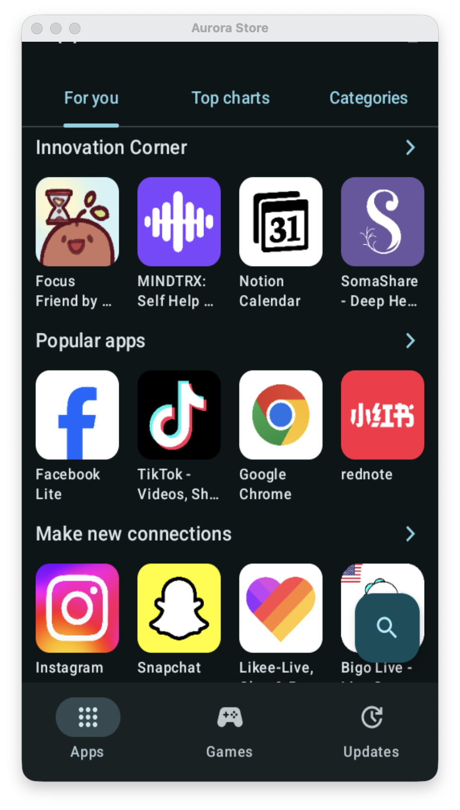
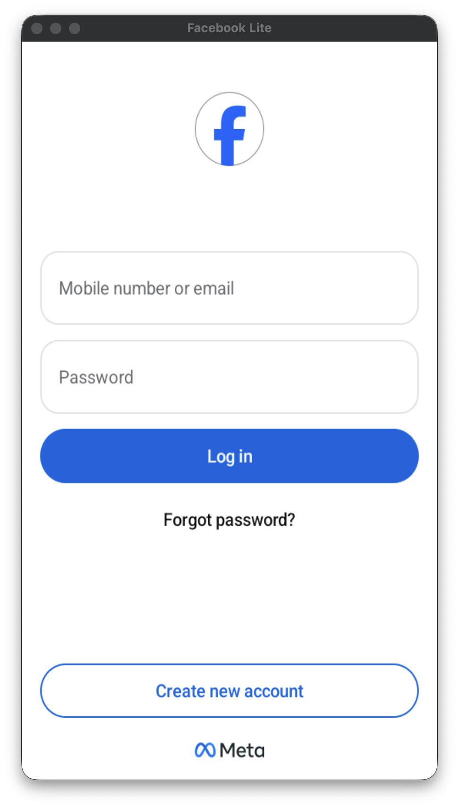

<div align="center">

# 🤖 Mac Subsystem for Android (MSA)

**Run Android applications seamlessly alongside Mac apps with native multi-window AppKit integration, Metal acceleration, and zero emulation overhead.**

[](LICENSE)
[](https://apple.com/macos)
[](#architecture)
[](https://swift.org)
[](https://github.com/nikhilpatil12/mac-subsystem-android/actions)

<p align="center">
  <a href="#key-features">Key Features</a> •
  <a href="#screenshots">Screenshots</a> •
  <a href="#architecture">Architecture</a> •
  <a href="#getting-started">Getting Started</a> •
  <a href="#cli-reference">CLI Reference</a> •
  <a href="#license">License</a>
</p>

</div>

---

## 💡 Overview

Traditional Android emulators (like BlueStacks, Nox, or Android Studio AVDs) simulate a full physical tablet or phone screen trapped inside a bulky, resource-heavy window with artificial desktop borders, heavy battery drain, and poor trackpad/mouse integration.

**Mac Subsystem for Android (MSA)** takes inspiration from **Windows Subsystem for Android (WSA)** and **Waydroid**, reimagining Android on macOS from first principles:

* **Headless MicroVM**: Boots a tailored Linux 6.6 kernel in **~20 seconds** directly using Apple's hypervisor-level `Virtualization.framework`.
* **True Multi-Window**: Every Android app opens in its own independent, floating macOS `NSWindow` with native traffic lights, drop shadows, and trackpad gestures.
* **Zero Emulation Overhead**: Runs native ARM64 code on Apple Silicon at near-bare-metal speeds with dynamic memory ballooning.

---

## 📸 Screenshots

<div align="center">
  <table>
    <tr>
      <td align="center"><b>Aurora Store (Native Window)</b></td>
      <td align="center"><b>Facebook Lite (Native Window)</b></td>
    </tr>
    <tr>
      <td></td>
      <td></td>
    </tr>
  </table>
  <p><i>Multiple Android apps running simultaneously in separate, dedicated native macOS windows with pure edge-to-edge content.</i></p>
</div>

---

## ✨ Key Features

* 🪟 **Independent App Windows**: Run multiple Android apps side-by-side simultaneously. Each app gets its own resizable `NSWindow`. Clicking between windows instantly shifts Android focus without frame bleeding or black screens.
* ⚡️ **Metal Hardware Acceleration (Option A)**: High-performance rendering pipeline powered by Apple Silicon Metal (`CAMetalLayer`, runtime MSL shaders, zero-copy texture ingestion) and a low-latency 60–120Hz GPU stream over `virtio-vsock` port 5050.
* 🚀 **Fast Cold Boot (~20s)**: Tuned microVM bootloader, parallelized DEX compilation across 8 vCPUs (`dex2oat`), USAP app pre-forking, and bypassed boot animations.
* 🎨 **Edge-to-Edge Native UI**: Automatically strips Android status bars, navigation bars, and `< _ [] X` freeform caption bars so apps feel like first-class Mac applications.
* 🔍 **Spotlight & Dock Integration**: Automatically creates authentic macOS `.app` bundles in `~/Applications/Android Apps/` with extracted high-resolution icons.
* 📁 **Host File & Clipboard Sharing**: Real-time two-way clipboard synchronization and seamless mounting of macOS `~/Downloads` into Android `/sdcard/Download` via `virtiofs`.
* ⌨️ **Trackpad & Keyboard Translation**: Natural scrolling, trackpad swipe gestures, and keyboard shortcuts (Cmd+C/V, Enter, Backspace, Esc/Back) mapped transparently.

---

## 🏛 Architecture

```
┌─────────────────────────────────────────────────────────────────┐
│                          macOS Host                             │
│                                                                 │
│   ┌──────────────────┐  ┌──────────────────┐                    │
│   │ Aurora Store.app │  │Facebook Lite.app │  (AppKit NSWindow) │
│   └────────▲─────────┘  └────────▲─────────┘                    │
│            │                     │                              │
│   ┌────────┴─────────────────────┴─────────────────────────┐    │
│   │ AppWindowManager & MetalRenderer                       │    │
│   │  - Hardware Apple Silicon GPU Shaders (MSL)            │    │
│   │  - CAMetalLayer Display Presentation (60–120Hz)        │    │
│   │  - GPUBridgeServer (Vsock Port 5050 GPU Transport)     │    │
│   │  - App Shims & Trackpad Input Bridge                   │    │
│   └──────────────────────────▲─────────────────────────────┘    │
└──────────────────────────────┼──────────────────────────────────┘
                               │ virtio-vsock (Ports 5000 / 5050 / 5555)
┌──────────────────────────────▼──────────────────────────────────┐
│               Linux MicroVM (Virtualization.framework)          │
│                                                                 │
│   ┌─────────────────────────────────────────────────────────┐   │
│   │ Android 13 Container (Waydroid / AOSP)                  │   │
│   │  - GPU Frame Streamer (msa-gpu-stream -> vsock:5050)    │   │
│   │  - SystemServer & ActivityTaskManager                   │   │
│   │  - Multi-window Task Routing                            │   │
│   │  - Immersive Fullscreen Policy                          │   │
│   └────────────────────────▲────────────────────────────────┘   │
│                            │ Binder IPC                         │
│   ┌────────────────────────▼────────────────────────────────┐   │
│   │ Monolithic Linux 6.6 Kernel                             │   │
│   │  - CONFIG_ANDROID_BINDERFS=y                            │   │
│   │  - CONFIG_NETFILTER monolithic & virtio drivers         │   │
│   │  - virtiofs shared folder (/sdcard/Download)            │   │
│   └─────────────────────────────────────────────────────────┘   │
└─────────────────────────────────────────────────────────────────┘
```

---

## 🚀 Getting Started

### Prerequisites

* macOS 13.0 (Ventura), 14.0 (Sonoma), or 15.0 (Sequoia).
* Apple Silicon (M1/M2/M3/M4) or Intel x86_64 Mac.
* Xcode Command Line Tools:
  ```bash
  xcode-select --install
  ```
* Android Platform Tools (`adb`):
  ```bash
  brew install android-platform-tools
  ```

### Building from Source

```bash
# Clone the repository
git clone https://github.com/nikhilpatil12/mac-subsystem-android.git
cd mac-subsystem-android

# Build and sign host binaries
make build
```

The compiled binaries will be placed in `build/bin/`:
* `msa-cli`: Command-line management tool and subsystem daemon.
* `msa`: Menu bar companion application.

### Setting Up the Guest Subsystem

Run the automated setup to initialize the Linux kernel, guest rootfs, and Android 13 system images:

```bash
./build/bin/msa-cli setup
```

---

## 💻 CLI Reference

| Command | Usage | Description |
| :--- | :--- | :--- |
| `start` | `msa-cli start [-d]` | Starts the MSA microVM subsystem daemon in foreground or background. |
| `install` | `msa-cli install <app.apk>` | Installs an APK and creates a native macOS `.app` bundle in `~/Applications/Android Apps/`. |
| `launch` | `msa-cli launch <package>` | Launches an Android app by package name in its own dedicated macOS window. |
| `shim` | `msa-cli shim <pkg> <name>` | Generates a macOS App Shim bundle for Spotlight and Dock launching. |
| `status` | `msa-cli status` | Displays the current microVM status, ADB connectivity, and running apps. |
| `stop` | `msa-cli stop` | Gracefully shuts down the Android subsystem and microVM. |

### Example Workflow

```bash
# 1. Start the subsystem daemon
msa-cli start &

# 2. Install any standard Android APK
msa-cli install ~/Downloads/AuroraStore.apk

# 3. Launch the app (or open it via Spotlight)
msa-cli launch com.aurora.store

# 4. Launch a second app in its own separate window
msa-cli launch com.facebook.lite
```

---

## 🛠 Under the Hood

### MicroVM Boot Acceleration
1. **DEX Optimization (`dex2oat`)**: By configuring `dalvik.vm.boot-dex2oat-threads=8` and `dalvik.vm.dex2oat-threads=8`, package verification during first boot is distributed across all host cores instead of throttled to 2.
2. **Kernel Parameter Tuning**: Boot command line includes `quiet loglevel=2 mitigations=off` to eliminate console I/O stalls and CPU speculation barriers inside the isolated VM.
3. **Zygote USAP Pool**: Pre-forks unspecialized application processes ahead of time (`persist.device_config.runtime_native.usap_pool_enabled=true`), reducing app launch latency by 50%.

### AppKit Multi-Window Architecture
Unlike monolithic emulators that display a single static framebuffer, MSA's `AppWindowManager` tracks focused Android tasks. Background windows preserve their last rendered Metal frame while inactive, ensuring that multiple Android apps can sit open simultaneously on your Mac desktop without flickering or resource hogging.

---

## 🤝 Contributing

Contributions are warmly welcomed! Please read our [Contributing Guide](CONTRIBUTING.md) and [Code of Conduct](CODE_OF_CONDUCT.md) before submitting pull requests.

---

## 📄 License

This project is open-source software licensed under the **[MIT License](LICENSE)**.

---

<div align="center">
  <sub>Built with ❤️ for macOS & Android power users.</sub>
</div>
